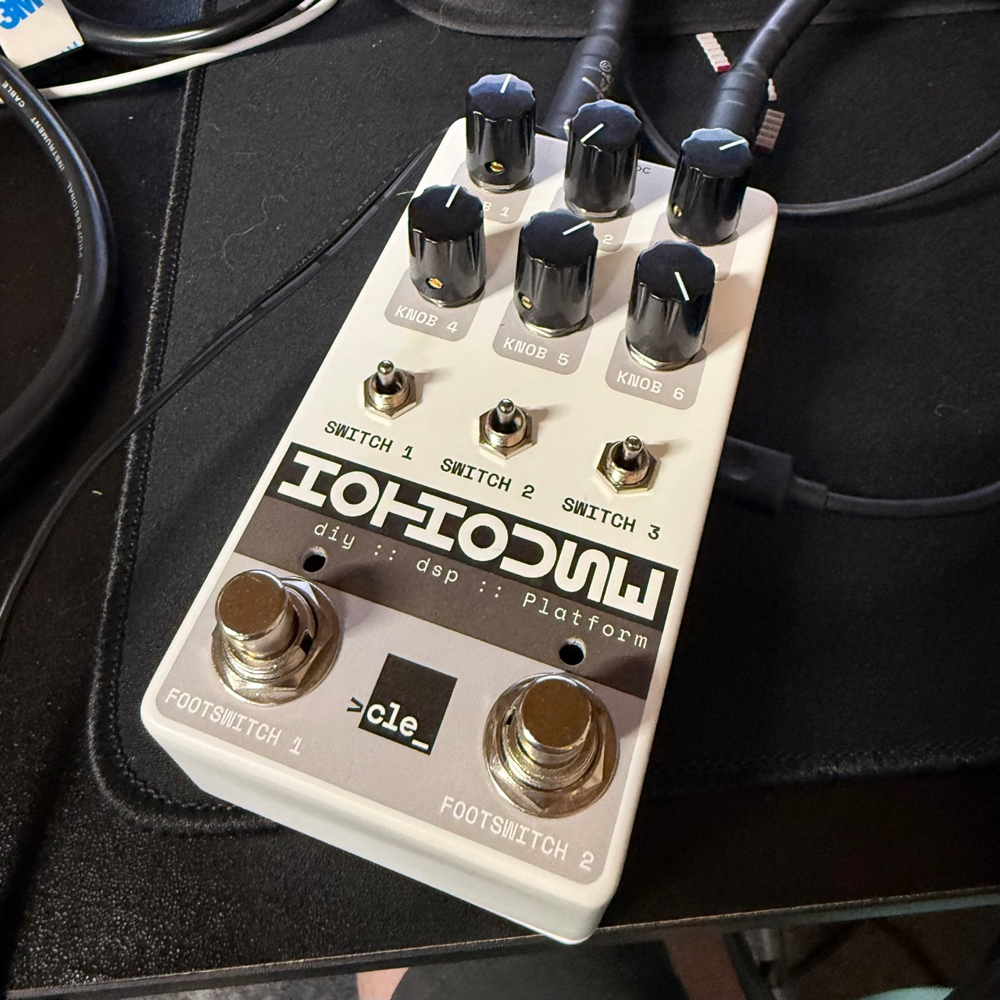

# Glasshouse

**Keep the touch. Bend the dynamics.**

Experimental creative-compressor firmware for the **Cleveland Music Co.
Hothouse**, inspired by the **Chase Bliss Clean**. Start with gentle glue,
lean into limiting, or push a chord until it folds into sag. Let your picking
open a filter. Turn the next phrase into a swell.



**Version 0.3.2 · Original Daisy Seed / stereo Hothouse · Early, playable, still evolving**

## Soft edges. Strange dynamics.

- **Compression → limiting → sag.** One Dynamics knob moves from subtle
  control to a deliberately collapsing response. Hold the right footswitch
  for maximum sag, then let it recover.
- **An EQ that listens.** Keep the tone fixed, let your playing open it, or
  introduce modulation. Darken the highs or thin out the lows.
- **Physics with a little give.** Spring-inspired motion adds a gentle bounce
  or a livelier flutter to gain reduction.
- **Swells without a volume pedal.** Hold the left footswitch for dynamic
  fades, or explore manual swells in the settings pages.
- **Wet and dry, separately.** Blend compressed sustain underneath an
  uncompressed attack, or lose the dry sound altogether.

Go further with gate and detector controls, Dusty-style drive, stereo spread,
parameter automation, **127 preset slots**, and **USB MIDI**. These deeper
features are implemented; their hardware validation is still in progress.

## Your first sound

1. Put all three toggles in the **middle**. Set **Wet, Attack and EQ to noon**,
   **Dry fully off**, **Sensitivity around 10–11 o'clock**, and **Dynamics
   around 9–10 o'clock**.
2. Tap and release the **right footswitch**. Glasshouse starts bypassed;
   the right LED lights when it is enabled.
3. Play gently, then dig in. Turn Sensitivity clockwise for more reduction.
   There is **no automatic makeup gain**—raise Wet to recover level.
4. Hold the **left footswitch before playing** to soften the next chord into
   a swell. Hold only the **right footswitch** to make a sustained chord sag.

For an HX Stomp effects loop, use instrument-level send/return and a **100%
FX Loop mix**. Start with send and return gains at 0 dB and a clean amp after
the loop. Keep the listening volume low while finding a sound.

## Know your panel

Front view, matching the numbers on the Hothouse:

```text
   1 SENSITIVITY    2 DYNAMICS       3 WET
   4 ATTACK         5 EQ             6 DRY

      RELEASE       EQ MODE        PHYSICS

          SWELL                  BYPASS / SAG
```

| Knob | What it does |
| --- | --- |
| **1 · SENSITIVITY** | Clockwise lowers the threshold: more of your playing triggers the response. |
| **2 · DYNAMICS** | Compression, then limiting, then sag. Fully left is 1:1. |
| **3 · WET** | Processed level. Noon is unity; clockwise adds gain. |
| **4 · ATTACK** | Compression onset and dynamic-EQ opening; also sets motion speed. |
| **5 · EQ** | Left removes highs; right removes lows; center is flat. |
| **6 · DRY** | Uncompressed level. Fully left is silent; noon is unity. |

| Toggle | Up | Middle | Down |
| --- | --- | --- | --- |
| **Left · Release** | Short, 50 ms | Custom | Long, 1.5 s |
| **Middle · EQ mode** | Playing-responsive | Fixed | Modulated |
| **Right · Physics** | Gentle spring | Stable | Lively spring |

- **Left footswitch:** swell; momentary dynamic swell is the default.
- **Right footswitch:** tap for enable/bypass; hold at least 0.4 seconds for
  maximum sag. Releasing a hold does not toggle bypass.
- **Both briefly pressed and released:** advance the settings page.
- **Both held for three seconds:** USB firmware-update mode.

The left LED shows gain reduction or swell level. The right LED shows effect
on/off. Knobs use pickup after page changes, MIDI or preset recall: move through
the stored position before taking control. Toggles update when physically moved.

The [HTML field guide](docs/glasshouse-cheat-sheet.html) adds a pedal diagram
and page-by-page reference. Download and open it in a browser. The
[full controls guide](docs/CONTROLS.md) explains Envelope, Options, Automation
and Presets.

## Three places to start exploring

**Bowed chords.** Keep Dry off, darken EQ slightly, and hold the left switch
before playing. Put delay and reverb after Glasshouse for overlapping pads.

**Brightness under your fingers.** Put the middle toggle up and EQ around
9–10 o'clock. Find a Sensitivity setting where accented notes open the filter
but soft notes stay dark. Attack slows the opening; Release slows the return.
Start with moderate Dynamics. Deep EQ cuts can produce a large level rise when
the filter opens—this is not an automatically level-matched sweep.

**A collapsing second layer.** Add a little Dry under the compressed sound.
Hold the right switch during a chord's tail: the wet layer falls away while the
dry guitar keeps its outline. Release before the next phrase.

## Try it on your Hothouse

You'll need a **stereo Hothouse with an original STM32H750 Daisy Seed**, USB
access, and an installed Daisy bootloader. **Seed3 is not targeted by this
build.** Glasshouse replaces the current effects application.

**No compiler needed:** download the [v0.3.2 ready-to-flash ZIP](https://github.com/breakall/hothouse-glasshouse/releases/download/v0.3.2/glasshouse-v0.3.2.zip),
unzip it, and follow **FLASHING.md**. The [release page](https://github.com/breakall/hothouse-glasshouse/releases/tag/v0.3.2)
also has the standalone firmware and SHA-256 checksum.

The [flashing guide](docs/FLASHING.md) covers installation and recovery;
the [build guide](docs/BUILD.md) is for compiling it yourself. Default routing
is **mono in to both outputs**; select stereo explicitly in Options. Bypass
and the dry blend both pass through the ADC/DAC and firmware.

## Set a sound over USB MIDI

Glasshouse receives on **channel 1**. Control all four parameter pages, engage
swell or sag, and save or recall presets. Physical controls take over through
pickup. Stock Hothouse has no TRS/DIN MIDI input.

| Message | Action |
| --- | --- |
| **CC 14–19** | Performance knobs 1–6, values 0–127. |
| **CC 102** | 0–63 bypass; 64–127 effect on. |
| **CC 103 / 104** | Release/engage swell Aux or maximum sag. |
| **Program Change 1–127** | Recall a saved preset. |

The [MIDI guide](docs/MIDI.md) has the complete map, preset numbering and
macOS identity-check tool. This mapping is specific to Glasshouse; it is not
Clean preset or MIDI compatibility.

## A work in progress

Glasshouse uses its own digital DSP. It isn't Chase Bliss firmware, a measured
circuit model, or an exact Clean recreation.

- **Played on hardware:** bypass, unity gain, compression, EQ, Wet/Dry levels,
  release, swell, and sag. The early compression wobble and sag switching pops
  were fixed and confirmed by listening on v0.3.2.
- **Attack needs more listening:** its control and timing were measured on the
  pedal, and its effect on dynamic EQ is audible. The compression-transient
  difference was not clear in the initial test setup.
- **Physics is subtle** in the tested setup. Dynamic EQ can change loudness
  substantially at deep cuts; no automatic level compensation is provided.
- **Still to validate fully:** stereo/sidechain operation, advanced options,
  automation, preset power-cycle persistence, and real-time CPU headroom.
- Preset saves briefly mute audio. Interrupted writes can lose the saved bank.
  MIDI clock, expression/CV, analog dry and analog true bypass are not provided.

Automated audio and control tests pass. Broader playing tests are welcome.
See [validation notes](docs/VALIDATION.md) for the tested scope and remaining
questions.

## Open source, independent, grateful

GPL-3.0-or-later. See [LICENSE](LICENSE) and [NOTICE](NOTICE).
Built on [Electrosmith libDaisy](https://github.com/electro-smith/libDaisy)
and the [Cleveland Music Co. Hothouse driver](https://github.com/clevelandmusicco/HothouseExamples).
Inspired by [Chase Bliss Clean](https://www.chasebliss.com/clean).
Not affiliated with or endorsed by Chase Bliss, Cleveland Music Co. or Electrosmith.
